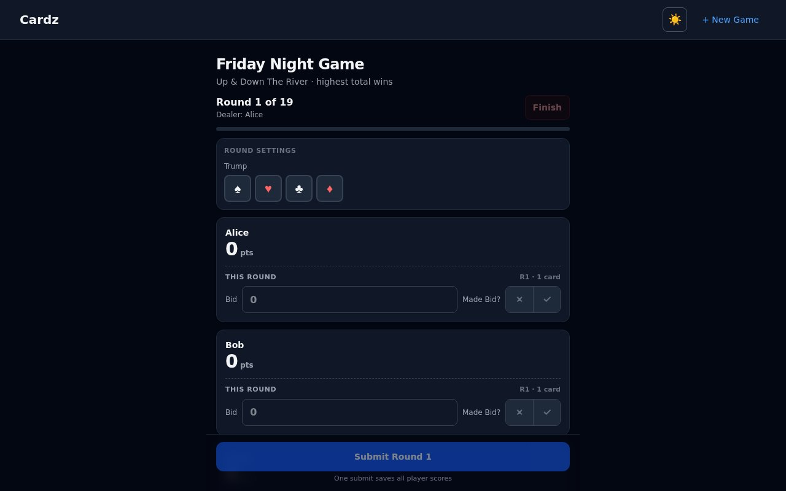

# Cardz

A local-first, installable PWA card game scorekeeper. Track sessions, players, rounds, and scores for your favorite card games.

[Hosted on GitHub Pages](https://jacobodden.github.io/cardz/). No server, no sync, no sign-in: all data stays in your browser (IndexedDB via Dexie.js).

## Games

- [**Up and Down the River**](docs/games/up-and-down.html): trick-taking; bid the exact number of tricks you will win. Highest total wins.
- [**Pay Me**](docs/games/pay-me.html): Contract Rummy over 11 rounds. Lowest total wins.
- [**High Score**](docs/games/high-score.html): open-ended points for any game where the highest total wins.
- [**Low Score**](docs/games/low-score.html): open-ended points for any game where the lowest total wins.

Built with Vite, React 19, Tailwind CSS v4 and Dexie.js. `npm install`, then `npm run dev` (localhost:5173); `npm run test:unit` and `npm run test:e2e` for the tests. Every script is listed in [Architecture](docs/architecture.html#scripts).

## Docs

Start at [docs/index.html](docs/index.html): game rules, architecture (with the design, scripts, tests and CI), design history and earlier planning notes. Open the files in a browser; there is no build step.
